# Choropleth map

A choropleth map editor for the world and every continent.



Import a spreadsheet, choose a palette, and export a map. No accounts, API keys, tracking, or server-side processing.

## Run locally


```sh
npm start
```

Open **http://127.0.0.1:4173**. There is no `npm install` step.

Alternatively, run `python3 -m http.server 4173` and open the same port. Use an HTTP server: opening `index.html` directly with `file://` cannot load JavaScript modules and map data.

## What it does

- World, Africa, Asia, Europe, North America, South America, Oceania, and Antarctica.
- 242 country and territory features, with island markers and country/ISO matching.
- CSV, TSV, pasted tables, and `.xlsx` imports; files stay in the browser.
- Numeric values or distinct language counts. Duplicate country totals are summed; duplicate language codes are counted once per country.
- Six palettes, custom colors, editable scale, country labels, an optional legend, and optional export captions.
- Editable SVG, 2400-pixel-wide PNG, and normalized CSV exports.
- Responsive layout, keyboard-accessible controls, and a searchable country table.

The two-column sample (Country, Value) has 22 synthetic country values across all seven continents. It is included to demonstrate the app, not as a real statistic.

## Data format

Two columns are required: **Country** and **Value**. Extra columns are ignored. [Download sample.csv](examples/sample.csv).

```csv
Country,Value
Canada,72
ETH,85
JP,64
```

Zero and negative values work. Missing and invalid values are reported rather than treated as zero. A failed import leaves the current map intact.

Language data uses two required columns, **Code** and **Countries Spoken**. **Language** is an optional third column:

```csv
Code,Language,Countries Spoken
en,English,"Canada,United States"
fr,French,"Canada,France"
```

See the [in-app guide](guide.html) for Excel sheet selection, aliases, region behavior, and export details. Downloadable examples are in [`examples/`](examples/).

SVG exports have transparent backgrounds. PNG exports have white backgrounds. **Include title & caption** controls both preview and exports; turn it off along with Legend and Country names for map geometry only.


## Development

```sh
npm test        # Node's built-in test runner; no installation
npm run build   # Optional static distribution in dist/
```


## Geography and limitations

Map data comes from [Natural Earth 1:50m v5.1.2](https://github.com/nvkelso/natural-earth-vector/tree/v5.1.2/geojson), in the public domain. It uses Natural Earth's default de facto boundaries and is intended for visualization. Small or disputed territories may be generalized; feature count is not a count of sovereign states.

- World uses Equal Earth; continent views use Mercator; Antarctica uses a south-polar stereographic projection.
- Regions use geographic frames, so outlying parts of a country may be cropped. The world view includes every feature. The region table includes all assigned countries/territories, even those outside its frame.
- Transcontinental countries can appear in more than one region. Offshore territory groupings are documented in the guide.
- ISO codes are used where available. Natural Earth identifiers distinguish features without unique ISO codes, including `ATC`, `IOA`, `CYN`, `KAS`, `KOS`, and `SOL`.
- `.xlsx` reads saved cell values, not formulas. It searches the first 25 nonempty rows of each sheet and prefers language-code sheets, then the largest matching sheet. Use CSV to explicitly choose a sheet. `.xls` and password-protected workbooks are unsupported.
- Data is held in memory. Refreshing clears the imported session. CSV exports keep aggregated totals, not original workbook formatting.
- No service worker: run a local copy for offline use. A hosted page must load its bundled assets before it can work.

To regenerate the trimmed dataset, download the pinned upstream GeoJSON and run:

```sh
python3 scripts/prepare-map.py /path/to/ne_50m_admin_0_countries.geojson
```

## License

Application code: [MIT](LICENSE). 
